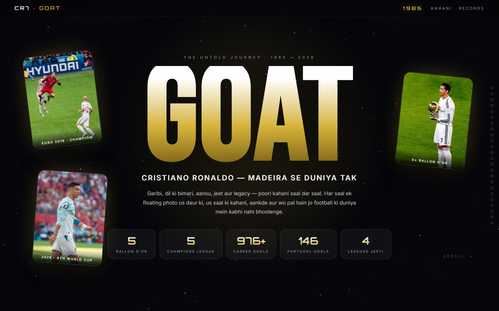

# 🐐 GOAT · CR7 — Poori Kahani (A se Z)

Cristiano Ronaldo ki poori kahani — **1985 se 2026 tak, saal dar saal**.
Har saal ki apni floating 3D photo, us daur ki kahani, season sheet aur records —
ek premium, animated, single-page experience.



## ✨ Features

- **24 year-chapters** (1985 → 2026) — har saal ki poori Hinglish story
- **Floating era photos** — har saal ki asli photo glass frame me, 3D tilt + glow + orbit rings
- **Club-color theming** — Sporting green, United red, Real white/violet, Juventus black-white, Al-Nassr yellow-blue, trophy years gold
- **Cinematic effects** — starfield + shooting stars, film grain, vignette, cursor glow, mouse parallax
- **Loader** with percentage, right-side **year rail**, scroll progress bar
- **Marquee** stats strip, chapter numbers (01/24), glass stats panels
- **Legacy section** — 8 records, photo gallery, 7 seekh, golden CR7 signature
- Fully **responsive** (mobile/tablet) + `prefers-reduced-motion` support
- **Zero dependencies** — pure HTML/CSS/JS, no frameworks, no build step

## 🚀 Chalana / Host karna

**Local:** bas `index.html` double-click karein (fonts ke liye internet chahiye).

**GitHub Pages (host):**
1. Repo fork ya clone karein
2. **Settings → Pages → Source: `Deploy from a branch`**
3. Branch: `main`, folder: `/ (root)` → Save
4. Kuch seconds me live: `https://<username>.github.io/cr7-goat-website/`

## 🗂 Project structure

```
cr7-goat-website/
├── index.html      # Loader, hero, timeline container, legacy, footer
├── style.css       # Saare premium 3D styles + responsive
├── app.js          # 24 chapters ka data (kahani + stats + colors + photo)
├── preview.jpg     # README preview screenshot
└── assets/img/     # Era photos (Wikimedia Commons) + signature
```

Kahani/ya photo badalni ho? **`app.js` ke `CHAPTERS` array** me saal-wise entry edit karein.

## 📚 Content sources

Fox Sports · beIN Sports · Al Jazeera · TNT Sports · Olympics.com · Sportskeeda
(jaankari 10 October 2026 tak)

## 🖼️ Image credits

Saari photos **Wikimedia Commons** se hain (free licenses: CC BY-SA / CC0 / public domain).
Har file ki exact license: `https://commons.wikimedia.org/wiki/File:<naam>`

| Local file | Wikimedia Commons file |
|---|---|
| funchal_sunset.jpg | Funchal at Sunset.jpg |
| funchal_old.jpg | Vista do Funchal, 1936.jpg |
| cr7_sporting_museum.jpg | C.Ronaldo at Museum Mundo Sporting.JPG |
| cr7_cr7jpl.jpg | CR7.JPG |
| cr7_statue.jpg | Cristiano Ronaldo statue, Madeira.jpg |
| cr7_utmchel.jpg | Ronaldo - Manchester United vs Chelsea.jpg |
| cr7_utd_chelsea2.jpg | Ronaldo - Manchester United vs Chelsea (cropped-3-4).jpg |
| cr7_2007_shev.jpg | Cristiano Ronaldo and Andriy Shevchenko, 2007 (cropped).jpg |
| cr7_wc2006.jpg | FIFA World Cup 2006, Iran 0-2 Portugal (11).jpg |
| cr7_2008_celtic.jpg | Cristiano Ronaldo - Celtic 2008.jpg |
| cr7_2008_utd.jpg | Cristiano Ronaldo of Manchester United, November 5, 2008.jpg |
| cr7_2009_kaka.jpg | Kaka and Cristiano Ronaldo of Real Madrid, August 29, 2009.jpg |
| cr7_2012.jpg | Cristiano Ronaldo, 2012.JPG |
| cr7_4609.jpg | Cristiano Ronaldo 4609.jpg |
| cr7_ballondor.jpg | Cristiano Ronaldo - Ballon d'Or (cropped).jpg |
| cr7_2016.jpg | 1 cristiano ronaldo 2016.jpg |
| cr7_2017.jpg | Cristiano Ronaldo (35609138466).jpg |
| cr7_2018.jpg | Ronaldo in 2018.jpg |
| cr7_2019_juve.jpg | 2019-20 Serie A - Torino v Juventus - Cristiano Ronaldo (cropped).jpg |
| cr7_2021_wapsi.jpg | Manchester United v Newcastle United, 11 September 2021 (10).jpg |
| cr7_wc2022.jpg | Cristiano Ronaldo WC2022 - 02.jpg |
| cr7_alnassr23.jpg | RonaldoAl-Nassr23.jpg |
| cr7_2023.jpg | Cristiano Ronaldo in 2023.jpg |
| cr7_2026a.jpg | Cristiano Ronaldo Croatia v Portugal 2 July 2026-075 (cropped).jpg |
| cr7_2026b.jpg | Cristiano Ronaldo Croatia v Portugal 2 July 2026-087.jpg |
| cr7_0876.jpg | Cristiano Ronaldo 0876.jpg |
| cr7_5098.jpg | "Cristiano Ronaldo" (5098214382).jpg |
| cr7_signature.svg | Cristiano Ronaldo Signature.svg |

## ⚖️ License

Fan tribute / educational project — non-commercial.
Story text: public information sources (see above). Photos: Wikimedia Commons licenses (credited above).
